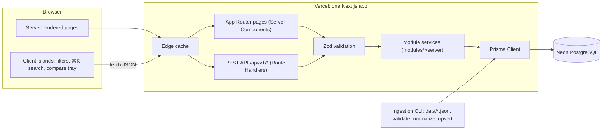
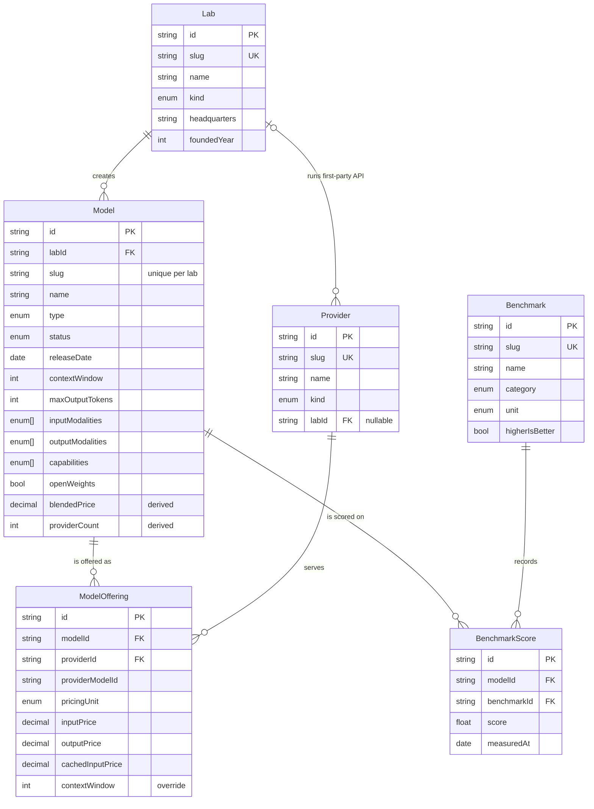

# OneAtlas — Architecture

> **Status:** proposal for review, Nov 22, 2026 · **Role:** Full Stack Engineer · **Deadline:** Nov 23, 3 pm

## 1. What we're building

OneAtlas helps developers, AI engineers and researchers **discover, compare and evaluate AI models** across labs and providers. The live oneatlas.dev is organized as **Models · Rankings · Benchmarks · Labs · Providers** with ⌘K global search. We follow the same information architecture so the product feels familiar, and put our effort into data quality, comparison and rankings.

Rules from the brief that shape everything below:

- Next.js, React, TypeScript, Tailwind on the frontend. Node.js + TypeScript API. PostgreSQL + Prisma.
- All application data comes from the database through APIs. Nothing is hardcoded in the frontend.
- Deliverables: live URL, GitHub repo, a 5–10 minute Loom on architecture and decisions.

---

## 2. System overview



Data moves through the system in three ways:

1. **Page request.** Browser → edge cache → Server Component → parse search params with Zod → service → Prisma → Postgres → HTML. Pages are cached and regenerated in the background when stale.
2. **Interactive request.** ⌘K search, the compare picker and the cost calculator call `fetch('/api/v1/…')` → Route Handler → Zod → the same service → JSON.
3. **Ingestion.** `npm run ingest` reads `data/*.json`, validates every record, normalizes units and names, writes only what changed in one transaction, recomputes derived columns and records an `IngestionRun`.

Pages and the API call the **same service functions** with the **same Zod schemas**. So `/models?lab=anthropic` and `/api/v1/models?lab=anthropic` can never return different results.

---

## 3. Tech stack

| Layer               | Choice                                               | Why                                                                                                                                                               |
| ------------------- | ---------------------------------------------------- | ----------------------------------------------------------------------------------------------------------------------------------------------------------------- |
| Framework           | Next.js (App Router, latest stable)                  | Required. UI and API ship as one app with one deploy.                                                                                                             |
| Language            | TypeScript, `strict`                                 | Required. Prisma types flow from the database to the UI.                                                                                                          |
| Styling             | Tailwind CSS + shadcn/ui (Radix primitives)          | Required (Tailwind). Radix gives accessible dialogs, popovers and the command menu. shadcn copies the component code into our repo, so we own and can explain it. |
| API                 | Next.js Route Handlers under `/api/v1`               | Required option. No second server to deploy, no CORS.                                                                                                             |
| Validation          | Zod                                                  | One schema validates query params, API input and ingestion data, and produces TypeScript types.                                                                   |
| Database            | PostgreSQL on Neon                                   | Required (Postgres). Neon is serverless with a free tier, a pooled connection endpoint for serverless functions, and branching for test databases.                |
| ORM                 | Prisma                                               | Required. Typed queries, versioned migrations, simple seeding.                                                                                                    |
| Client server-state | A small `useSearch` hook                             | Only two widgets fetch on the client (⌘K search and the compare picker). Debounce plus AbortController handles stale requests without a library.                  |
| Client UI state     | URL search params, plus Zustand for the compare tray | See decision D4.                                                                                                                                                  |
| Charts              | Small SVG/CSS bars, Recharts only where needed       | Keeps the JavaScript bundle small.                                                                                                                                |
| Tests               | Vitest (unit + API), Playwright (smoke)              | Fast, TypeScript-native.                                                                                                                                          |
| CI/CD               | GitHub Actions + Vercel                              | Typecheck, lint, test and build on every push. Every PR gets a preview deploy.                                                                                    |
| Hosting             | Vercel (primary) + Neon                              | See D19 and section 14.                                                                                                                                           |

---

## 4. Key decisions and reasoning

Each decision lists what we chose, why, and the trade-off we accept.

**D1. One Next.js app for UI and API, not NestJS.**
_Why:_ One codebase, one deploy, shared types, no CORS. The workload is read-heavy CRUD, which Route Handlers handle well.
_Trade-off:_ Less built-in structure than NestJS. We get it back with an explicit layered design (D2).

**D2. Layered backend: route → validation → service → database.**
Route Handlers only translate HTTP: they parse input, call a service and format the response. Business logic lives in each module's `server/service.ts` (D18). Only those files touch Prisma.
_Why:_ Each layer can be tested on its own, logic is never duplicated, and swapping the transport (for example, adding GraphQL later) touches one layer.
_Trade-off:_ A little more boilerplate per endpoint.

**D3. Pages call services directly; client islands call the REST API.**
_Why:_ A Server Component fetching its own API over HTTP adds a network hop and breaks during the build. Calling the service is faster and fully typed. The REST API is still a real product feature: OneAtlas is a developer platform, and the API powers search, compare and the calculator.
_Trade-off:_ Two entry points into the services, kept consistent by sharing Zod schemas.

**D4. The URL is the state for filters, sorting, pagination and comparisons.**
_Why:_ Every view becomes a shareable link, the back button works, pages render on the server with the right data, and we don't need a global store. Only the compare tray, which must follow you across pages, lives in Zustand persisted to `localStorage`.
_Trade-off:_ Filter changes cause a server round trip. We wrap them in `useTransition` so the UI stays responsive.

**D5. Neon serverless Postgres with pooled connections.**
_Why:_ Serverless functions open many short-lived connections. Neon's pooled endpoint (PgBouncer) prevents running out of connections. Migrations use the direct, non-pooled URL.
_Trade-off:_ Possible cold start on the free tier. Edge caching (D15) hides most of it.

**D6. Labs and Providers are separate tables, joined by `ModelOffering`, which carries the price.**
_Why:_ They are different roles. A **lab** creates a model (Meta creates Llama). A **provider** serves it (Groq, Together and Bedrock serve Llama). The same model costs different amounts at different providers, so price belongs to the model–provider pair, not to the model. When a lab also runs an API (Anthropic, OpenAI), its provider row links back with an optional `labId`.
_Trade-off:_ Showing "the price" of a model needs an aggregate, which we pre-compute (D9).

**D7. Money is `Decimal`, stored in USD per million tokens, with an explicit `pricingUnit`.**
_Why:_ Floating-point numbers drift (0.1 + 0.2 ≠ 0.3), which breaks sorting and comparisons of prices. Per-million-tokens is the unit the industry shows. Converting at ingestion keeps the UI simple and removes tiny, error-prone numbers like `0.000003`. Image, speech and video models aren't priced per token, so `pricingUnit` stops us from comparing $/image to $/token.
_Trade-off:_ Decimals serialize as strings, so the DTO mappers convert them to numbers in one place.

**D8. Modalities and capabilities are Postgres enum arrays, not join tables or boolean columns.**
_Why:_ The vocabulary is small and fixed (tool calling, reasoning, …). Enums are type-checked end to end, one column holds the whole set, "has all of these" is a single `hasEvery` filter, and a GIN index makes it fast.
_Trade-off:_ Adding a capability requires a migration. That's acceptable for a vocabulary that changes a few times a year. A join table would only pay off if capabilities needed their own data.

**D9. Price and availability stats are denormalized onto `Model`.**
`minInputPrice`, `minOutputPrice`, `blendedPrice` and `providerCount` are copies of facts that live in `ModelOffering`.
_Why:_ "Sort models by cheapest price" would otherwise need a grouped subquery on every request, and Prisma can't sort by an aggregate of a related field. With stored columns it's an indexed `ORDER BY`.
_Trade-off:_ Copies can go stale. We prevent that with D10: only one code path writes them, and it recomputes them in the same transaction.

**D10. The public API is read-only. All writes go through the ingestion pipeline.**
_Why:_ A single write path is what keeps derived columns, units and slugs consistent. No public write endpoints also means no auth surface to secure in an MVP.
_Trade-off:_ Updating data means re-running ingestion. An authenticated admin endpoint that calls the same pipeline is a clean extension.

**D11. A curated, versioned dataset plus a validation and normalization pipeline, rather than live scraping.**
_Why:_ The brief allows mock data but requires it to go through the database and APIs. A dataset committed to the repo is reproducible, reviewable in pull requests, and works offline. The pipeline (Zod validation, unit conversion, slug generation, deduplication, idempotent diff-based writes) is the same code a live source would use. A source adapter interface leaves room for live feeds. The OpenRouter public endpoint we checked returned a sparse shape with no pricing, so the MVP doesn't depend on it.
_Trade-off:_ Data is a snapshot. The UI labels it as sample data and shows "data updated" from the last `IngestionRun`.

**D12. Offset pagination with totals, not cursors.**
_Why:_ People want page numbers and "1,118 results". At our data size, `OFFSET` is cheap.
_Trade-off:_ Offset gets slower on huge tables and can shift while data changes. Cursor pagination is the upgrade path for API consumers at scale.

**D13. Search uses case-insensitive substring matching, backed by trigram (`pg_trgm`) indexes.**
_Why:_ Model names like `gpt-5.5-mini` or `llama-4-maverick-17b` split badly into words, so Postgres full-text search matches them poorly. Substring matching does what users expect, and trigram GIN indexes keep `ILIKE '%…%'` fast as the table grows. Results are ranked as exact match, then prefix match, then substring match.
_Trade-off:_ No typo tolerance in the MVP. Trigram similarity scoring or an external engine (Meilisearch, Typesense) is the upgrade path. At ~100 rows Postgres will simply scan the table, which is faster anyway. The index is there so the code doesn't change when the data does.

**D14. Rankings are computed when read, from normalized scores, then cached.**
_Why:_ Benchmarks use different scales (percent vs. Elo), so we normalize each to 0–100 before averaging (see section 9). With tens of models this takes microseconds, and the formula stays in one readable, unit-tested function.
_Trade-off:_ At thousands of models we'd precompute rankings during ingestion into a table or materialized view (section 12).

**D15. Aggressive caching, because data only changes on ingestion.**
_Why:_ The catalog is read thousands of times for every write. Pages use incremental static regeneration (ISR). API responses send `Cache-Control: public, s-maxage=300, stale-while-revalidate=3600`, so the Vercel edge serves most requests without touching the database.
_Trade-off:_ Up to 5 minutes of staleness after an ingest, which is fine for a catalog. Ingestion can also trigger on-demand revalidation.

**D16. Public IDs are slugs namespaced by lab, like `anthropic/claude-opus-5-5`. Database IDs stay internal.**
_Why:_ This is the `author/model` convention developers already know from Hugging Face and OpenRouter. URLs are readable and stable, and a model name only has to be unique within its lab.
_Trade-off:_ Looking up a model needs the lab slug too. A composite unique index makes that a single index lookup.

**D17. The API is versioned under `/api/v1`.**
_Why:_ External developers integrate with a developer platform's API. Versioning lets the contract change later without breaking them.
_Trade-off:_ None meaningful.

**D18. Code is organized by feature module, not by layer.**
Each feature (catalog, compare, rankings, labs, providers, search) owns its whole stack in one folder: Zod schemas, service, DTOs, components, tests. Other code reaches it only through its public entry points: `index.ts` (client-safe) and `server/index.ts` (server-only).
_Why:_ A feature can be built, tested, reviewed or removed without touching the others. Several people (or sessions) can work in parallel. Each scaling fix in section 12 lands inside one module. A module could later become its own service, because everything else already talks to it through a small public interface. ESLint rules enforce the boundaries, so they don't depend on discipline.
_Trade-off:_ A few more files, and one extra import hop compared with a flat layer layout.

**D19. Vercel + Neon, no containers.**
_Why:_ Vercel runs Next.js with no configuration, including its edge CDN, and its free tier never sleeps. Neon gives serverless Postgres with a pooled endpoint. A Docker image was planned for portability, but it was dropped because Docker wasn't available on the build machine and nothing in the deployment needs it.
_Trade-off:_ Tied to Vercel-style hosting for now. Next.js runs on any Node host, so moving later is a configuration change.

---

## 5. Database

### 5.1 Entity–relationship diagram



### 5.2 Tables at a glance

| Table            | One row is…                                         | Key relationships                                    | Notable rules                                 |
| ---------------- | --------------------------------------------------- | ---------------------------------------------------- | --------------------------------------------- |
| `Lab`            | A company or research group that **creates** models | has many `Model`; may run `Provider`s                | `slug` unique                                 |
| `Provider`       | A platform that **serves** models through an API    | has many `ModelOffering`; optional link to its `Lab` | `slug` unique                                 |
| `Model`          | One AI model (e.g. Claude Opus 5.5)                 | belongs to one `Lab`; has many offerings and scores  | `(labId, slug)` unique; derived price columns |
| `ModelOffering`  | "Model X is available at provider Y for $Z"         | joins `Model` ↔ `Provider` (many-to-many with data)  | `(modelId, providerId)` unique; prices ≥ 0    |
| `Benchmark`      | A test such as SWE-bench Verified or GPQA Diamond   | has many `BenchmarkScore`                            | describes its scale and direction             |
| `BenchmarkScore` | "Model X scored S on benchmark B"                   | joins `Model` ↔ `Benchmark`                          | `(modelId, benchmarkId)` unique               |
| `IngestionRun`   | One execution of the data pipeline                  | none                                                 | powers "data updated" and audit               |

### 5.3 Prisma schema

```prisma
// ─────────────────────────── Enums ───────────────────────────

enum LabKind {
  COMPANY
  RESEARCH_INSTITUTE
  OPEN_COMMUNITY
}

enum ProviderKind {
  FIRST_PARTY        // a lab's own API: OpenAI API, Anthropic API
  CLOUD              // hyperscalers: AWS Bedrock, Google Vertex AI, Azure
  INFERENCE_PLATFORM // specialist hosts: Groq, Together, Fireworks
  AGGREGATOR         // routers in front of many providers: OpenRouter
}

enum ModelType {
  TEXT
  EMBEDDING
  IMAGE
  VIDEO
  SPEECH         // text-to-speech
  TRANSCRIPTION  // speech-to-text
  RERANKING
}

enum ModelStatus {
  ACTIVE
  PREVIEW
  DEPRECATED
}

enum Modality {
  TEXT
  IMAGE
  AUDIO
  VIDEO
  FILE
}

enum Capability {
  TOOL_CALLING
  STRUCTURED_OUTPUT
  REASONING
  PROMPT_CACHING
  FINE_TUNING
  WEB_SEARCH
}

enum PricingUnit {
  PER_MILLION_TOKENS
  PER_IMAGE
  PER_MINUTE
  PER_MILLION_CHARACTERS
  PER_THOUSAND_SEARCHES // rerankers
}

enum BenchmarkCategory {
  REASONING
  KNOWLEDGE
  CODING
  MATH
  AGENTIC
  MULTIMODAL
  LONG_CONTEXT
  HUMAN_PREFERENCE
}

enum ScoreUnit {
  PERCENT // 0–100
  ELO     // arena-style ratings
  POINTS  // any other scale, bounded by minScore/maxScore
}

enum IngestionStatus {
  SUCCEEDED
  FAILED
}

// ─────────────────────────── Tables ───────────────────────────

model Lab {
  id           String     @id @default(cuid())
  slug         String     @unique
  name         String
  kind         LabKind    @default(COMPANY)
  description  String?
  website      String?
  headquarters String?    // country
  foundedYear  Int?
  logoUrl      String?
  models       Model[]
  providers    Provider[] // first-party APIs run by this lab
  createdAt    DateTime   @default(now())
  updatedAt    DateTime   @updatedAt

  @@index([name(ops: raw("gin_trgm_ops"))], type: Gin)
}

model Provider {
  id          String          @id @default(cuid())
  slug        String          @unique
  name        String
  kind        ProviderKind
  description String?
  website     String?
  docsUrl     String?
  logoUrl     String?
  labId       String?         // set only for a lab's own API
  lab         Lab?            @relation(fields: [labId], references: [id], onDelete: SetNull)
  offerings   ModelOffering[]
  createdAt   DateTime        @default(now())
  updatedAt   DateTime        @updatedAt

  @@index([kind])
  @@index([name(ops: raw("gin_trgm_ops"))], type: Gin)
}

model Model {
  id               String       @id @default(cuid())
  slug             String       // unique within its lab; public id is "lab/slug"
  name             String
  family           String?      // e.g. "Claude 5", "Llama 4"; groups releases on lab pages
  labId            String
  lab              Lab          @relation(fields: [labId], references: [id], onDelete: Restrict)
  type             ModelType
  status           ModelStatus  @default(ACTIVE)
  description      String?
  releaseDate      DateTime?    @db.Date
  knowledgeCutoff  DateTime?    @db.Date
  contextWindow    Int?         // tokens
  maxOutputTokens  Int?         // tokens
  parametersB      Float?       // billions; usually only published for open weights
  openWeights      Boolean      @default(false)
  license          String?
  inputModalities  Modality[]   @default([])
  outputModalities Modality[]   @default([])
  capabilities     Capability[] @default([])

  // Derived from ModelOffering. Written only by the ingestion pipeline (D9, D10).
  pricingUnit      PricingUnit?
  minInputPrice    Decimal?     @db.Decimal(10, 4)
  minOutputPrice   Decimal?     @db.Decimal(10, 4)
  blendedPrice     Decimal?     @db.Decimal(10, 4) // cheapest (3·input + output) / 4
  providerCount    Int          @default(0)

  offerings        ModelOffering[]
  scores           BenchmarkScore[]
  createdAt        DateTime     @default(now())
  updatedAt        DateTime     @updatedAt

  @@unique([labId, slug])
  @@index([type, status])
  @@index([releaseDate(sort: Desc)])
  @@index([contextWindow])
  @@index([blendedPrice])
  @@index([capabilities], type: Gin)
  @@index([inputModalities], type: Gin)
  @@index([name(ops: raw("gin_trgm_ops"))], type: Gin)
}

model ModelOffering {
  id               String      @id @default(cuid())
  modelId          String
  model            Model       @relation(fields: [modelId], references: [id], onDelete: Cascade)
  providerId       String
  provider         Provider    @relation(fields: [providerId], references: [id], onDelete: Cascade)
  providerModelId  String      // the id you send to this provider's API
  pricingUnit      PricingUnit @default(PER_MILLION_TOKENS)
  inputPrice       Decimal     @db.Decimal(10, 4) // USD per unit; 0 means free
  outputPrice      Decimal?    @db.Decimal(10, 4) // null when there are no output tokens (embeddings)
  cachedInputPrice Decimal?    @db.Decimal(10, 4)
  contextWindow    Int?        // null = model default; some hosts cap it lower
  maxOutputTokens  Int?
  quantization     String?     // e.g. "fp8" on open-weights hosts
  throughputTps    Float?      // median output tokens per second
  latencyMs        Int?        // median time to first token
  createdAt        DateTime    @default(now())
  updatedAt        DateTime    @updatedAt

  @@unique([modelId, providerId])
  @@index([providerId])
}

model Benchmark {
  id             String            @id @default(cuid())
  slug           String            @unique
  name           String
  category       BenchmarkCategory
  description    String?
  unit           ScoreUnit         @default(PERCENT)
  higherIsBetter Boolean           @default(true)
  minScore       Float?            // scale bounds used for normalization
  maxScore       Float?
  sourceUrl      String?
  scores         BenchmarkScore[]
  createdAt      DateTime          @default(now())
  updatedAt      DateTime          @updatedAt

  @@index([category])
}

model BenchmarkScore {
  id          String    @id @default(cuid())
  modelId     String
  model       Model     @relation(fields: [modelId], references: [id], onDelete: Cascade)
  benchmarkId String
  benchmark   Benchmark @relation(fields: [benchmarkId], references: [id], onDelete: Cascade)
  score       Float
  measuredAt  DateTime? @db.Date
  sourceUrl   String?
  createdAt   DateTime  @default(now())
  updatedAt   DateTime  @updatedAt

  @@unique([modelId, benchmarkId])
  @@index([benchmarkId, score(sort: Desc)])
}

model IngestionRun {
  id         String          @id @default(cuid())
  source     String          // e.g. "curated@2026-11-22"
  status     IngestionStatus
  startedAt  DateTime        @default(now())
  finishedAt DateTime?
  stats      Json?           // inserted / updated / unchanged counts per table
  error      String?
}
```

The datasource uses a pooled `DATABASE_URL` for the app and a direct URL for migrations (D5). The exact config syntax depends on the installed Prisma version and is set up during scaffolding.

### 5.4 Indexes, and the query each one serves

| Index                                          | Serves                                                        |
| ---------------------------------------------- | ------------------------------------------------------------- |
| `Model (labId, slug)` unique                   | Model page lookup by `lab/model`; also covers "models by lab" |
| `Model (type, status)`                         | Default listing (active models of a type)                     |
| `Model (releaseDate desc)`                     | "Newest" sort and the Newest ranking                          |
| `Model (contextWindow)`                        | Context sort, "1M+ context" filter, Longest-context ranking   |
| `Model (blendedPrice)`                         | Price sort, Cheapest and Best-value rankings                  |
| `Model capabilities` GIN                       | "Supports tool calling AND reasoning" filter                  |
| `Model inputModalities` GIN                    | "Accepts images" filter                                       |
| `name` trigram GIN (Model, Lab, Provider)      | Substring search (D13)                                        |
| `ModelOffering (modelId, providerId)` unique   | Model page provider table; prevents duplicate listings        |
| `ModelOffering (providerId)`                   | "Filter by provider" and provider pages                       |
| `BenchmarkScore (modelId, benchmarkId)` unique | Model page scores; prevents duplicate scores                  |
| `BenchmarkScore (benchmarkId, score desc)`     | Per-benchmark leaderboards, already sorted                    |

### 5.5 Integrity rules

Data is protected twice: Zod rejects bad data during ingestion, and the database enforces the core rules even if someone bypasses the pipeline.

- **Foreign keys and delete rules.** Deleting a model cascades to its offerings and scores. Deleting a lab that still has models is blocked (`Restrict`), so a lab can't be removed by accident and take its catalog with it.
- **Uniqueness.** Slugs, one offering per model–provider pair, one score per model–benchmark pair.
- **CHECK constraints** (added with raw SQL in a migration, since Prisma doesn't model them):
  - all prices ≥ 0
  - `contextWindow` and `maxOutputTokens` > 0
  - slugs match `^[a-z0-9]+(-[a-z0-9]+)*$`
- **Extension.** The first migration runs `CREATE EXTENSION IF NOT EXISTS pg_trgm` before creating the trigram indexes.

### 5.6 Derived columns

After upserting offerings, the pipeline recomputes every model's derived columns in one SQL statement, inside the same transaction:

- `minInputPrice` = cheapest `inputPrice` across the model's offerings
- `minOutputPrice` = cheapest `outputPrice` across the model's offerings
- `blendedPrice` = cheapest `(3 × input + output) / 4` across offerings. Typical workloads read about three tokens for every one they write; 3:1 is the common industry blend. For models with no output price, it's the input price.
- `providerCount` = number of offerings
- `pricingUnit` = the unit shared by all of the model's offerings (the pipeline rejects mixed units for one model)

Because only this code writes those columns, they cannot drift from the offerings.

---

## 6. Data pipeline

```
data/*.json ──► load ──► validate (Zod) ──► normalize ──► upsert (1 transaction) ──► recompute derived ──► IngestionRun
                              │
                              └─ any invalid record: abort, print every error with file and path, write nothing
```

- **Validate.** Every record is checked: required fields, enum values, positive numbers, and that each referenced lab, provider and benchmark exists. All errors are collected and reported together, so a bad file gives one useful report instead of failing one error at a time.
- **Normalize.** Prices are converted to USD per unit (per-token → per-million). Names are slugified (`GPT-5.5 mini` → `gpt-5-5-mini`). Modality and capability aliases are mapped (`"vision"` → input `IMAGE`, `"function_calling"` → `TOOL_CALLING`). Dates become ISO dates. Whitespace is trimmed and duplicates are removed.
- **Sync (diff, then write).** Each table's current rows are read once and compared with the snapshot in memory (`planSync`), matched on natural keys (slugs). New rows go in with one bulk `createMany`, only rows whose values actually changed are updated, and rows missing from the snapshot are deleted. A full load takes about 20 statements, and re-running an unchanged snapshot writes nothing. That matters against a remote database like Neon, where an upsert per row (about 1,100 statements) took minutes. One transaction means a failed run leaves the previous good data untouched.
- **Source adapters.** `interface SourceAdapter { name: string; load(): Promise<RawDataset> }`. The MVP ships `CuratedJsonAdapter`. A live feed would be another adapter feeding the same validate and normalize steps.
- **Source formats.** Offerings deliberately use the formats vendors really publish: USD per 1M tokens, per 1K tokens (AWS, Azure), per-token decimal strings (OpenRouter's API), or non-token units (per image, second, hour, 1K characters, 1K searches). All of them normalize to one stored unit per model type, using exact decimal arithmetic.
- **Dataset.** 18 labs, 23 providers, 12 benchmarks, 81 models across all seven types, 228 offerings and 396 scores. It includes edge cases the UI must handle: preview and deprecated models, free offerings, and a self-host-only model with no offerings. Prices and scores are illustrative and labelled as sample data in the UI and README.
- **Guarded in CI.** A unit test validates the committed dataset on every push, with no database needed. Integration tests run the real pipeline against Postgres: full load, idempotent re-run, targeted update, pruning, and the CHECK constraints.

---

## 7. API

Base path `/api/v1`. All endpoints are `GET` and public. Responses are JSON.

| Endpoint                            | Purpose                                                                                                 |
| ----------------------------------- | ------------------------------------------------------------------------------------------------------- |
| `/models`                           | Search, filter, sort and paginate the catalog                                                           |
| `/models/{lab}/{model}`             | Full model record: lab, offerings with providers and prices, benchmark scores                           |
| `/compare?models=a/b,c/d`           | 2–4 models aligned for side-by-side display, plus the union of their benchmarks                         |
| `/facets`                           | Filter options with counts (labs, providers, types, capabilities), so the filter UI is never hardcoded  |
| `/rankings?board=…`                 | Leaderboards: `overall`, a benchmark category, `value`, `cheapest`, `context`, `newest`, `availability` |
| `/benchmarks`, `/benchmarks/{slug}` | Benchmark catalog; one benchmark's leaderboard                                                          |
| `/labs`, `/labs/{slug}`             | Lab directory; one lab with its models and releases                                                     |
| `/providers`, `/providers/{slug}`   | Provider directory; one provider's catalog and prices                                                   |
| `/search?q=`                        | Global search, results grouped as models / labs / providers                                             |
| `/health`                           | Liveness and database check for monitoring                                                              |

### `/models` query parameters

| Param               | Type                | Example                  | Meaning                                                                                              |
| ------------------- | ------------------- | ------------------------ | ---------------------------------------------------------------------------------------------------- |
| `q`                 | string, ≤ 100 chars | `claude`                 | Substring match on model name, lab name, description                                                 |
| `lab`               | comma list          | `anthropic,openai`       | Made by any of these labs                                                                            |
| `provider`          | comma list          | `aws-bedrock`            | Available at any of these providers                                                                  |
| `type`              | comma list          | `text,embedding`         | Any of these model types                                                                             |
| `capability`        | comma list          | `tool_calling,reasoning` | Has **all** of these capabilities                                                                    |
| `input`             | comma list          | `image`                  | Accepts **all** of these input modalities                                                            |
| `openWeights`       | boolean             | `true`                   | Only open-weights models                                                                             |
| `minContext`        | integer             | `200000`                 | Context window at least this many tokens                                                             |
| `maxPrice`          | number              | `5`                      | Blended USD per 1M tokens at most this                                                               |
| `includeDeprecated` | boolean             | `false` (default)        | Include deprecated models                                                                            |
| `sort`              | enum                | `blendedPrice`           | `name`, `releaseDate`, `contextWindow`, `inputPrice`, `outputPrice`, `blendedPrice`, `providerCount` |
| `order`             | `asc` / `desc`      | `asc`                    | Default depends on the sort (newest first, cheapest first, …)                                        |
| `page`, `pageSize`  | integers            | `1`, `24`                | `pageSize` capped at 100                                                                             |

Public values use lowercase `snake_case` (`tool_calling`). The validation layer maps them to database enums.

### Response shapes

```jsonc
// List
{
  "data": [
    {
      "id": "anthropic/claude-opus-5-5",
      "name": "Claude Opus 5.5",
      "lab": { "slug": "anthropic", "name": "Anthropic" },
      "type": "text",
      "status": "active",
      "releaseDate": "2026-…",
      "contextWindow": 1000000,
      "maxOutputTokens": 128000,
      "modalities": { "input": ["text", "image"], "output": ["text"] },
      "capabilities": ["tool_calling", "reasoning", "structured_output"],
      "openWeights": false,
      "pricing": { "unit": "per_million_tokens", "input": 0.0, "output": 0.0, "blended": 0.0 },
      "providerCount": 3
    }
  ],
  "meta": { "page": 1, "pageSize": 24, "total": 70, "totalPages": 3 }
}

// Error (same shape for every endpoint)
{ "error": { "code": "VALIDATION_ERROR", "message": "Invalid query parameters", "details": [ { "path": "sort", "message": "Expected one of …" } ] } }
```

- Errors: `VALIDATION_ERROR` → 400, `NOT_FOUND` → 404, `INTERNAL_ERROR` → 500. One `withApiHandler()` wrapper turns thrown errors into this shape, logs unexpected ones, and never leaks stack traces.
- DTO mappers turn database rows into the API contract: decimals become numbers, enums become lowercase, internal IDs are hidden. The database can change without breaking API consumers.
- Every successful `GET` sends CDN cache headers (D15).

---

## 8. Frontend

### Routes

| Route                               | Rendering                    | Contents                                                                                                       |
| ----------------------------------- | ---------------------------- | -------------------------------------------------------------------------------------------------------------- |
| `/`                                 | Static + ISR                 | Headline, global search, live counts from the DB, newest releases, leaderboard previews, capability coverage   |
| `/models`                           | Dynamic (URL params)         | Filter sidebar with counts, sort, table/cards toggle, pagination                                               |
| `/models/[lab]/[model]`             | Pre-rendered per model + ISR | Specs, pricing per provider, modalities, capabilities, benchmark scores, similar models, add to compare        |
| `/compare?models=…`                 | Dynamic                      | 2–4 models side by side, best value in each row highlighted, cost calculator ("10M in / 2M out tokens costs…") |
| `/rankings`, `/rankings/[board]`    | ISR                          | Overall, per-category, best value, cheapest, longest context, newest, most available                           |
| `/benchmarks`, `/benchmarks/[slug]` | ISR                          | Benchmarks grouped by category; per-benchmark leaderboard                                                      |
| `/labs`, `/labs/[slug]`             | ISR                          | Lab directory; lab page with release timeline and the providers serving its models                             |
| `/providers`, `/providers/[slug]`   | ISR                          | Providers grouped by kind; provider page with catalog and prices                                               |
| `/api-docs`                         | Static                       | Public API reference (stretch)                                                                                 |

Every route has `loading.tsx` (skeletons), `error.tsx` and a not-found state.

### Components and state

- **Server Components by default.** Client components only where there's interaction: filter controls, ⌘K command menu, compare tray, calculator, theme toggle. Less JavaScript is shipped and pages render faster.
- **Components live in their feature module** (`modules/catalog/components`, `modules/compare/components`, …), built on shared primitives in `platform/ui`.
- **State:**

| State                          | Lives in                                            | Why                                                |
| ------------------------------ | --------------------------------------------------- | -------------------------------------------------- |
| Filters, sort, page, view mode | URL search params                                   | Shareable, back button works, server-rendered (D4) |
| Compare selection              | URL on `/compare`; tray in Zustand + `localStorage` | Must survive navigation between pages              |
| Server data in client islands  | TanStack Query                                      | Caching, request dedupe, cancels outdated searches |
| Theme                          | `next-themes`                                       | Dark/light with no flash on load                   |

- **Responsive.** Tables become stacked cards below the `md` breakpoint, the filter sidebar becomes a sheet, and the compare grid scrolls horizontally with a sticky first column.

---

## 9. Rankings methodology

1. **Normalize each score to 0–100** using the benchmark's scale. `PERCENT` uses the score as is. `ELO` and `POINTS` use min–max scaling across the scored models (or the benchmark's `minScore`/`maxScore`). When `higherIsBetter` is false, the scale is inverted.
2. **Category index** = the mean of a model's normalized scores in that category. A model must have scores for at least half of the category's benchmarks to be ranked, so one lucky result can't top a board. Coverage is shown, e.g. "3 of 4 benchmarks".
3. **Overall index** = the mean of the model's category indexes, for models with results in at least three categories.
4. **Best value** = overall index ÷ blended price, among models with a price above 0. Free models are listed separately rather than dividing by zero.
5. **Simple boards** (cheapest, longest context, newest, most available) are indexed `ORDER BY`s on `Model` columns.

This logic lives in one pure, unit-tested function (`modules/rankings/server/score.ts`), and the formula is shown on the rankings page.

---

## 10. Reliability, security, performance, accessibility

- **Reliability.** All input is validated, errors use one shape, route-level error boundaries render, and `/api/health` checks the database. One Prisma client instance per server process prevents connection storms during hot reload.
- **Security.** The API is read-only. Prisma parameterizes all queries, and the only raw SQL uses tagged templates. Inputs are capped (`pageSize` ≤ 100, compare ≤ 4 models, `q` ≤ 100 characters). Server modules import `server-only`, so Prisma and secrets can't end up in the browser bundle. Secrets live in environment variables, never in git. Rate limiting (e.g. Upstash) is the next step for a public API.
- **Performance targets.** Lighthouse ≥ 90 on mobile for the listing and model pages. Static/ISR pages, edge-cached API, `next/font`, `next/image`, and minimal client JavaScript.
- **Accessibility.** Keyboard-operable ⌘K menu and filters (Radix), `aria-sort` on sortable headers, visible focus rings, AA contrast in both themes, and color never used as the only signal.

---

## 11. Testing and CI

| Level      | Tool           | Covers                                                                                                   |
| ---------- | -------------- | -------------------------------------------------------------------------------------------------------- |
| Unit       | Vitest         | Normalization (units, slugs, aliases), query parsing, ranking math, price formatting                     |
| API        | Vitest         | Route handlers against a seeded test database (a Neon branch): filters, sorts, pagination, 400/404 paths |
| End to end | Playwright     | Smoke path: search, open a model, add to compare, view comparison                                        |
| CI         | GitHub Actions | `typecheck`, `lint`, `test`, `build` on every push; Vercel preview per PR                                |

---

## 12. How it scales

### 12.1 Three properties make it scale

1. **The app servers hold no state.** Nothing is kept in memory between requests. State lives in the URL, the database, or the visitor's browser. So any number of copies can run side by side: Vercel adds function instances automatically as traffic grows, and on any other Node host you add instances behind a load balancer.
2. **Database load follows the number of distinct URLs, not the number of visitors.** Pages use ISR and API responses carry `s-maxage=300`. A popular page is computed roughly once per cache window per region, however many people view it. Ten visitors or a hundred thousand visitors to `/models/anthropic/claude-opus-5-5` cost the database about the same.
3. **Every query is bounded and indexed.** Filters and sorts hit indexes (section 5.4). Page size is capped at 100, compare at 4 models, search text at 100 characters, so no single request can ask for unbounded work. Each list is one query with an explicit `select`, with no query-per-row loops.

### 12.2 What breaks first, and where the fix goes

| Pressure                                              | First thing to strain                                | Fix                                                                        | Where the change lands |
| ----------------------------------------------------- | ---------------------------------------------------- | -------------------------------------------------------------------------- | ---------------------- |
| Many different filter combinations (fewer cache hits) | List and count queries on `/models`                  | Neon autoscaling + a read replica; cache facet counts                      | Config only            |
| Thousands of models                                   | Rankings load every score in a category on each read | Precompute rankings during ingestion into a table or materialized view     | `rankings` module      |
| API consumers paging very deep                        | `OFFSET 50000` still scans the skipped rows          | Cursor pagination (`?after=`) on the API                                   | `catalog` module       |
| Search at scale                                       | `ILIKE` has no relevance ranking or typo tolerance   | Trigram similarity ranking, then Meilisearch/Typesense synced by ingestion | `search` module        |
| Heavy or abusive API clients                          | Nothing throttles them                               | API keys + rate limiting (Upstash Redis) in `withApiHandler`               | `platform` module      |
| Data must refresh often                               | Ingestion is run by hand                             | Scheduled ingestion (Vercel Cron) + price history table                    | `ingestion` module     |

The right-hand column is the point of the module design (D18): every scaling fix lands in one module, and nothing else changes.

### 12.3 Honest limits of the MVP setup

- **Free tiers.** Neon's free compute suspends when idle, so the first request after a quiet spell waits briefly while it resumes. Vercel's Hobby plan is for non-commercial use. Both are fine for a demo, and both are fixed by a plan upgrade, not a code change.
- **One database writer.** Postgres has a single primary. That's fine here because only ingestion writes.
- **Not load-tested yet.** The claims above follow from the design. A k6 load test against a preview deploy is how we'd put real numbers on them (stretch goal).

---

## 13. Modules

### 13.1 Module map

| Module      | Owns (pages · API)                                                                                                         | Tables                                                    | Public surface                                                                                                     | Depends on                               |
| ----------- | -------------------------------------------------------------------------------------------------------------------------- | --------------------------------------------------------- | ------------------------------------------------------------------------------------------------------------------ | ---------------------------------------- |
| `platform`  | Layout, nav, theme, UI primitives, `withApiHandler`, error types, env check, Prisma client, formatters, shared Zod helpers | —                                                         | `@/platform/*`                                                                                                     | nothing                                  |
| `database`  | `prisma/schema.prisma`, migrations, CHECK constraints                                                                      | defines all                                               | Generated Prisma types                                                                                             | —                                        |
| `ingestion` | `data/*.json`, `scripts/ingest/*`                                                                                          | **writes** all                                            | `npm run ingest`                                                                                                   | platform, database                       |
| `catalog`   | `/models`, `/models/[lab]/[model]` · `/api/v1/models*`, `/api/v1/facets`                                                   | reads Model, ModelOffering, Lab, Provider, BenchmarkScore | `listModels`, `getModel`, `getModelsByIds`, `getFacets`; `ModelTable`, `ModelCard`, `PriceTag`, `CapabilityBadges` | platform                                 |
| `rankings`  | `/rankings*`, `/benchmarks*` · `/api/v1/rankings`, `/api/v1/benchmarks*`                                                   | reads Benchmark, BenchmarkScore, Model                    | `getBoard`, `listBenchmarks`, `getBenchmark`; `LeaderboardTable`, `ScoreBar`                                       | platform                                 |
| `search`    | ⌘K menu · `/api/v1/search`                                                                                                 | reads Model, Lab, Provider                                | `searchAll`; `CommandMenu`                                                                                         | platform                                 |
| `labs`      | `/labs*` · `/api/v1/labs*`                                                                                                 | reads Lab, Model                                          | `listLabs`, `getLab`                                                                                               | platform, catalog (cards)                |
| `providers` | `/providers*` · `/api/v1/providers*`                                                                                       | reads Provider, ModelOffering, Model                      | `listProviders`, `getProvider`                                                                                     | platform, catalog (cards)                |
| `compare`   | `/compare`, compare tray, cost calculator · `/api/v1/compare`                                                              | through catalog                                           | `CompareTray`, `useCompareStore`                                                                                   | platform, catalog, search (model picker) |
| `home`      | `/` (lives in `src/app/page.tsx`, no folder of its own)                                                                    | through catalog and rankings                              | —                                                                                                                  | catalog, rankings                        |
| `delivery`  | CI workflow, integration and e2e tests, README                                                                             | —                                                         | —                                                                                                                  | tests everything                         |

Only `ingestion` writes to the database. Every other module only reads.

### 13.2 Inside a module

```
src/modules/catalog/
├── index.ts          # client-safe public surface: components and types   → @/modules/catalog
├── schemas.ts        # Zod: list query + route params, shared by the page and the API
├── components/       # ModelTable, FilterSidebar, SortSelect, PricingTable, …
└── server/
    ├── index.ts      # server-only public surface; first line is import "server-only"  → @/modules/catalog/server
    ├── service.ts    # listModels, getModel, getFacets (the only Prisma callers)
    ├── queries.ts    # builds Prisma where / orderBy from a validated query
    ├── dto.ts        # database row → API contract
    └── *.test.ts
```

`src/app/` only does routing. Each page and route file is a few lines that call into a module:

```ts
// src/app/api/v1/models/route.ts
import { withApiHandler } from "@/platform/http";
import { listModels, modelListQuery } from "@/modules/catalog/server";

export const GET = withApiHandler(async (req) => {
  const query = modelListQuery.parse(Object.fromEntries(req.nextUrl.searchParams));
  return listModels(query); // { data, meta }
});
```

The whole repository:

```
.
├── data/                      # curated dataset                 (ingestion)
├── prisma/                    # schema + migrations             (database)
├── scripts/ingest/            # pipeline                        (ingestion)
├── src/
│   ├── app/                   # routing only: page and route files
│   ├── modules/
│   │   └── catalog/ compare/ rankings/ search/ labs/ providers/
│   └── platform/
│       └── db/ health/ http/ ui/ layout/ validation/ format/ env.ts
├── tests/                     # integration setup, e2e (Playwright)  (delivery)
├── .github/workflows/          # CI                              (delivery)
└── docs/ARCHITECTURE.md
```

### 13.3 Boundary rules, enforced by ESLint

1. Files in `src/app/` import a module only through `@/modules/<name>` or `@/modules/<name>/server`, never its internals.
2. Modules import each other only through those same public entry points.
3. Only `src/modules/*/server/**`, `src/platform/**` and `scripts/ingest/**` may import the Prisma client.
4. Client components can't import a module's `server` entry: the `server-only` package fails the build if they do.
5. No import cycles. Dependencies point one way: home and compare → catalog, rankings, search → platform.

Rules 1–3 are `no-restricted-imports` patterns and rule 5 is `import/no-cycle`. Breaking any of them fails `npm run lint`, and therefore CI.

### 13.4 Build order

| Wave      | Modules                         | In parallel?     | Why this order                                                       |
| --------- | ------------------------------- | ---------------- | -------------------------------------------------------------------- |
| 1         | platform → database → ingestion | No, in sequence  | Everything needs the shared code, the schema and real data           |
| 2         | catalog, rankings, search       | Yes              | Each depends only on platform                                        |
| 3         | labs, providers, compare        | Yes              | They reuse catalog's cards; compare also uses search                 |
| 4         | home                            | —                | Composes catalog and rankings                                        |
| Alongside | delivery                        | Starts in wave 1 | CI goes in early so every later wave is checked; e2e tests come last |

Each module in waves 2 and 3 touches only its own folder plus a few thin route files, which is what makes parallel work safe. Shared files (navigation links, `package.json`) are settled in wave 1.

---

## 14. Deployment

**Production:** Vercel (app) + Neon (Postgres). No containers: a Docker image was planned, but it was dropped because Docker Desktop wasn't available on the development machine and Vercel needs no image.

1. Create a Neon project. Use the **pooled** connection string for `DATABASE_URL` and the **direct** one for `DIRECT_URL`.
2. From your machine, with `DIRECT_URL` pointing at Neon: `npm run db:deploy` (migrations), then `npm run ingest` (dataset).
3. Import the GitHub repo into Vercel and add `DATABASE_URL` (pooled). Leave `NEXT_BUILD_CPUS` and `DATABASE_POOL_MAX` unset.
4. Deploy. The build prerenders every catalog page from Neon, so the database must be reachable at build time.

**Rendering with Cache Components (Next.js 16).** Service functions use `'use cache'` with `cacheLife('hours')` and the tag `catalog`. Pages without request data (model, lab, provider, benchmark and ranking pages, the home page) are prerendered at build time and refreshed hourly. Pages that read the query string (`/models`, `/compare`) prerender a static shell and stream their results inside `<Suspense>`. API routes send CDN cache headers (D15).

**Local database.** `npm run db:dev` starts Prisma's local Postgres (`prisma dev`), with no Docker needed. It accepts few concurrent connections, so `.env` sets `DATABASE_POOL_MAX=1` and `NEXT_BUILD_CPUS=1` for local builds. CI runs the integration tests against a real `postgres:17` service.

**Vercel or Render?** Vercel for this submission. Render's free web services sleep after 15 idle minutes and take about a minute to wake, which a reviewer opening the link cold would hit. Render also offers edge caching only on paid plans (checked Nov 22, 2026). Render would be the better fit if the app needed long-running workers or predictable per-instance pricing.

---

## 15. Plan to the deadline

| Phase                   | Output                                                                                            | Target                     |
| ----------------------- | ------------------------------------------------------------------------------------------------- | -------------------------- |
| 1 · Foundation (wave 1) | `platform` module, strict TS, lint + boundary rules, local Postgres (`prisma dev`), CI            | Tonight                    |
| 2 · Data (wave 1)       | `database` + `ingestion` modules: schema, migrations, curated dataset, pipeline tests             | Tonight                    |
| 3 · Wave 2              | `catalog`, `rankings`, `search`: services, API routes, pages, tests                               | Tonight into early morning |
| 4 · Wave 3              | `labs`, `providers`, `compare` + cost calculator                                                  | Tomorrow morning           |
| 5 · Wave 4              | Home page                                                                                         | Tomorrow morning           |
| 6 · Polish              | Responsive pass, loading/empty/error states, dark mode, SEO, accessibility, Lighthouse, e2e tests | By 12:30                   |
| 7 · Ship                | Neon + Vercel production deploy, smoke test on the live URL, README, Loom talking points          | **Code freeze 1:00 pm**    |
| —                       | Record Loom, submit the form                                                                      | 1:00–3:00 pm (you)         |

---

## 16. What's needed from you

1. **Review this document.** Approve it or tell me what to change.
2. **Neon**, needed for the live deploy only (local development runs on `prisma dev`): create a free project, then put its pooled and direct connection strings in a local `.env` file. I'll provide `.env.example`; `.env` is never committed.
3. **GitHub:** create an empty repo, or run `gh auth login` so the repo can be created from here.
4. **Vercel:** sign in with GitHub, import the repo, and add the same two environment variables.
5. **Loom + Google Form:** recorded and submitted by you. I'll prepare a talking-points script from this document.
